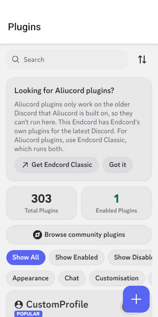
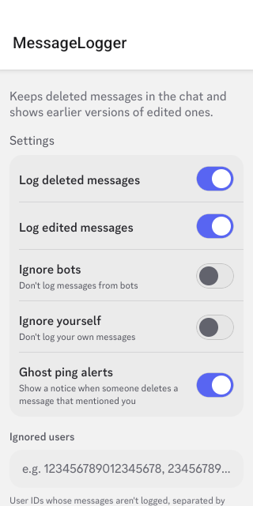
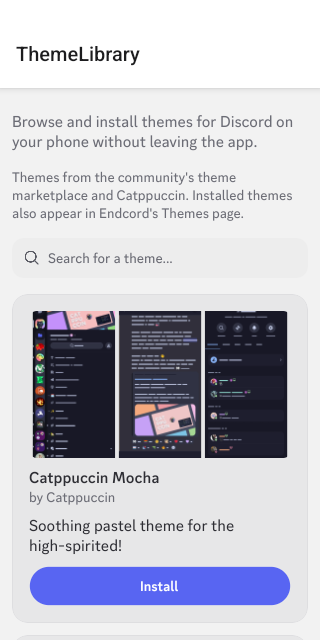

# Endcord for Android

**Plugins, themes and privacy for the Discord app on your phone.**

[Website](https://endcord.com) · [Endcord PC](https://github.com/rootpoii/endcord) · [Endcord Classic](https://github.com/rootpoii/endcord-mobile/tree/main) · [Plugin list](docs/PLUGINS.md)

&nbsp;&nbsp;
&nbsp;&nbsp;

## Features

- **303 plugins built in.** 261 of them come from Endcord PC and 42 are made for phones. They are all off until you
  turn them on, each with its own settings, and you can search and filter them by tag like on desktop. See the
  [full list](docs/PLUGINS.md).
- **Themes and fonts.** Browse community themes and Catppuccin without leaving the app, or add your own. The status
  bar follows your theme.
- **Private by default.** NoTrack is on from the start, so Discord's analytics, telemetry and crash reports are never
  sent.
- **Your language.** English, Türkçe, Русский, Español and Français, following Discord's language or the one you pick.
- **Light on older phones.** Only a list of plugins loads when Discord starts. A plugin's code loads the first time you
  turn it on.
- **Always up to date.** Endcord updates itself every time the app starts, and the installer rebuilds it when Discord
  updates.
- **Hard to break.** A plugin that fails turns itself off and tells you why, instead of crashing Discord. Safe Mode
  and a recovery menu are always one step away.
- **Compatible.** Vendetta and Revenge plugins and themes work too, and you can browse community plugins in the app.

## Install

No root needed. Endcord installs next to Discord as a separate app, and your Discord stays exactly as it is.

1. Download **[Endcord Installer](https://github.com/rootpoii/endcord-mobile/releases/download/next-installer-v1.0.0/endcord-installer-v1.0.0.apk)**
   and open it. If Android asks, allow your browser to install apps.
2. In **Endcord Installer**, tap **Install**. It uses the Discord on your phone, or downloads the latest one.
3. Open **Endcord** and sign in. Endcord's settings are in Discord's settings, under **Endcord**.

Requires Android 9 or newer. If Google Play Protect warns about the installer, tap **More details → Install anyway**:
it warns about every app that doesn't come from the Play Store.

<b>Rooted? Run Endcord inside the real Discord with LSPosed</b>

 

Nothing is reinstalled: the Play Store Discord runs Endcord.

1. Install [LSPosed](https://github.com/JingMatrix/LSPosed) or another Xposed framework.
2. Download `endcord-xposed.apk` from the [`builds-next` branch](https://github.com/rootpoii/endcord-mobile/tree/builds-next)
   and install it.
3. In LSPosed, enable the **Endcord Xposed** module for **Discord** (`com.discord`).
4. Force-stop Discord and open it again.

## FAQ

<b>Can I use Aliucord plugins?</b>

 

Not in this app. Aliucord plugins are written for the older Discord that Aliucord is built on and can't run on the
current one. [Endcord Classic](https://github.com/rootpoii/endcord-mobile/tree/main) runs both Endcord's and
Aliucord's plugins, and Endcord Installer can set it up for you.

<b>How do I update?</b>

 

You don't need to do anything. Endcord downloads its newest version every time the app starts. When Discord updates,
Endcord Installer sends a notification: tap it to rebuild Endcord. The installer also tells you when a new version of
itself is out.

<b>Endcord won't start, or a plugin broke something</b>

 

- Shake the phone, or hold two fingers on the screen for 3 seconds right after Endcord opens, for the recovery menu:
  reload, recovery mode (plugins and themes off), delete the downloaded Endcord, or reset the loader settings.
- Endcord → General → **Safe Mode** reloads without plugins and themes.
- A plugin that fails to start turns itself off and says so. Turn it back on after the next update.

<b>Will I get banned?</b>

 

Client mods are against Discord's Terms of Service. Bans for using one are rare, but they can happen, so use Endcord
at your own risk. Plugins that act for you, like scheduled messages, stay off until you turn them on.

## Contributing

Bug reports, translations and plugins are welcome: open an issue or come to our
[Discord](https://discord.gg/endcord). [docs/DEVELOPMENT.md](docs/DEVELOPMENT.md) explains how the repository is laid
out, how to build and test Endcord, and how releases work; [docs/PLUGINS.md](docs/PLUGINS.md) shows how to write a
plugin.

## Credits and license

Endcord for Android is a fork of [Revenge](https://github.com/revenge-mod), which continues Bunny and Vendetta; see
[UPSTREAM.md](UPSTREAM.md) for the exact upstream commits. It would not exist without them,
[LSPatch](https://github.com/LSPosed/LSPatch) and the Vendetta tracker mirrors that serve the Discord APKs.
MessageLogger and FakeNitro follow the approaches of the
[Revenge community plugins](https://github.com/revenge-mod/revenge-community-plugins) (GPL-3.0); oneko's cat is
[oneko.js](https://github.com/adryd325/oneko.js) by adryd; ThemeLibrary lists [Catppuccin](https://github.com/catppuccin/vendetta)
and the community [theme marketplace](https://github.com/kmmiio99o/theme-marketplace).

© 2026 rootpoi and contributors. Each directory keeps the license of the project it was forked from: `bundle/`
BSD-3-Clause, `loader/` GPL-3.0, `installer/` OSL-3.0. Endcord's plugins (`bundle/src/plugins`) and the other files
marked `SPDX-License-Identifier: GPL-3.0-or-later` are GPL-3.0-or-later, like Endcord PC, so the built bundle as a
whole is distributed under the GPL-3.0. The original copyright notices of Team Vendetta, pylixonly and Team Revenge
are kept in the source files and shown in the installer's About screen.

Endcord is not affiliated with or endorsed by Discord Inc. or the Revenge team.
